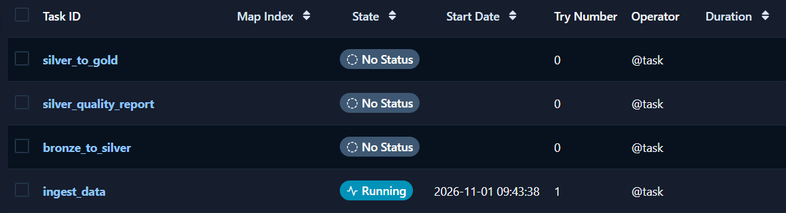
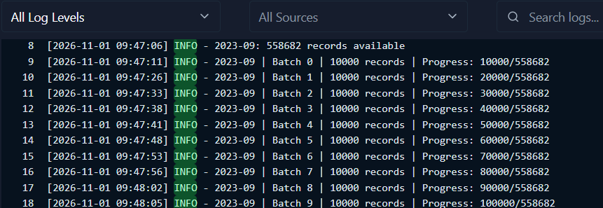
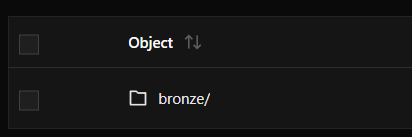
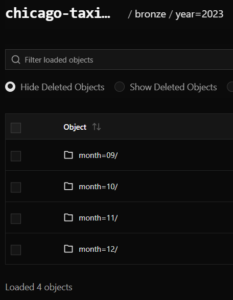
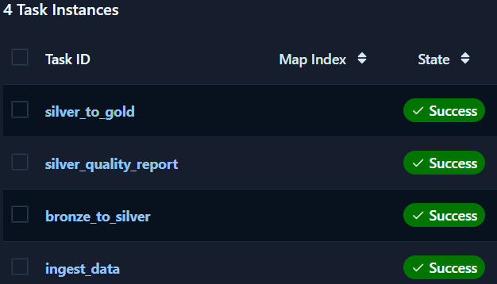
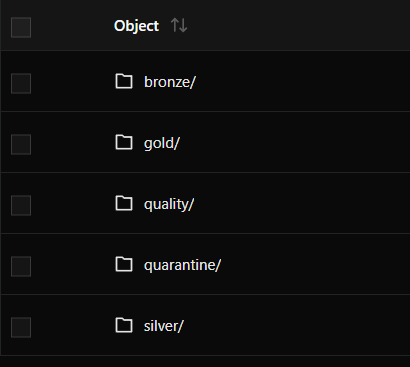
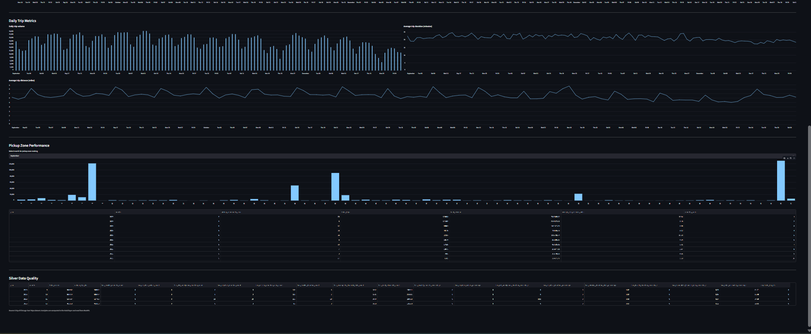

# Pipeline Data Engineering Chicago Taxi

Un projet de data engineering complet, construit avec Python, Apache Airflow, PySpark, RustFS et Streamlit.

Le pipeline récupère les trajets de taxis de Chicago sur le portail officiel de la ville et les range dans un data lake compatible S3. Les données sont ensuite transformées selon une architecture Medallion. Avant de produire les données analytiques qui alimentent le dashboard, plusieurs contrôles qualité sont effectués.

## Résultats

Le pipeline traite les données de septembre à décembre 2023.

| Indicateur | Résultat |
|---|---:|
| Enregistrements ingérés | 2 158 006 |
| Lots d'ingestion | 217 |
| Enregistrements Silver | 2 158 006 |
| Enregistrements en quarantaine | 0 |
| Revenus journaliers | 122 lignes |
| Indicateurs journaliers | 122 lignes |
| Performance des zones | 308 lignes |

## Documentation

Le dossier `docs/` regroupe les détails techniques du projet :

- [Architecture](docs/architecture.md)
- [Data Dictionary](docs/data_dictionary.md)
- [Technical Decisions](docs/technical_decisions.md)

## Installation et démarrage

### Prérequis

- Docker Desktop avec WSL2 sous Windows
- Git
- 8 Go de RAM recommandés
- Une connexion Internet

Pas besoin d'installer Spark séparément, ni d'avoir un compte cloud.

### 1. Récupérer le projet

```powershell
git clone https://github.com/aymane70/artefact-chicago-taxi-data-engineering.git
cd artefact-chicago-taxi-data-engineering
```

### 2. Démarrer les services

Assurez-vous que Docker Desktop est lancé, puis exécutez :

```powershell
docker compose up --build -d
```

Pour vérifier que les conteneurs ont bien démarré :

```powershell
docker compose ps
```

Cette commande lance Airflow, RustFS et Streamlit. Aucune configuration supplémentaire n'est requise et il n'y a pas de fichier `.env` à créer : tous les paramètres se trouvent déjà dans `docker-compose.yml`.

> [!NOTE]
> **Choix volontaire :** les paramètres sont directement dans `docker-compose.yml` pour que le projet démarre en une seule commande et soit facile à tester pour le reviewer. Dans un vrai déploiement, les identifiants seraient externalisés.
### 3. Accéder aux interfaces

| Service | URL |
|---|---|
| Airflow | [http://localhost:8080](http://localhost:8080) |
| Console RustFS | [http://localhost:9001](http://localhost:9001) |
| Dashboard Streamlit | [http://localhost:8501](http://localhost:8501) |

**Airflow**

Si une authentification vous est demandée, consultez les logs :

```powershell
docker compose logs airflow
```

**RustFS**

Identifiants de démonstration :

```text
Username: CHICAGO_TAXI_ADMIN
Password: ChicagoTaxi_DE_Project_2026_Key
```

Le bucket utilisé est `chicago-taxi-lake`.

**Dashboard**

Le dashboard présente les résultats Gold et les rapports qualité stockés dans RustFS. Il devient utilisable une fois le pipeline exécuté.

## Exécuter le pipeline

1. Ouvrez Airflow ([http://localhost:8080](http://localhost:8080)) et cherchez le DAG `chicago_taxi_pipeline`.
2. Activez-le s'il est en pause.
3. Cliquez sur **Trigger DAG**.
4. Suivez l'exécution des quatre tâches, qui se lancent l'une après l'autre :

| Tâche | Rôle |
|---|---|
| `ingest_data` | Extrait les données vers la couche Bronze |
| `bronze_to_silver` | Nettoie et valide les données |
| `silver_quality_report` | Génère les rapports qualité |
| `silver_to_gold` | Produit les données analytiques |

### Suivre l'avancement

**Dans les logs Airflow.** Cliquez sur la tâche `ingest_data`, puis sur **Logs**. L'ingestion est la plus longue étape, et les logs affichent la progression lot par lot :

| Tâche `ingest_data` dans Airflow |
|:---:|
|  |

| Logs de l'ingestion, lot par lot |
|:---:|
|  |

Chaque mois est extrait puis vérifié. Quand la ligne `Reconciliation successful` apparaît, le mois est complet et le pipeline passe au suivant (octobre, novembre, décembre).

**Dans RustFS, en temps réel.** Ouvrez la console ([http://localhost:9001](http://localhost:9001)), puis le bucket `chicago-taxi-lake`. Pendant l'ingestion, vous voyez les fichiers apparaître au fur et à mesure dans `bronze/year=2023/month=09/` : un fichier `batch_xxxxx.jsonl` par lot, et le fichier `_manifest.json` du mois. Les dossiers `silver/`, `quality/` et `gold/` apparaissent ensuite, à mesure que les tâches suivantes se terminent.

| Fichiers Bronze qui apparaissent pendant l'ingestion |
|:---:|
|  |

| Bronze complet : les quatre mois ingérés |
|:---:|
|  |

> [!NOTE]
> **Bon à savoir :** l'API de Chicago peut être très sollicitée ou répondre lentement. Voir des nouvelles tentatives pendant l'ingestion est donc normal :
>
> ```text
> WARNING - Request failed: ... Read timed out. (read timeout=180). Retrying in 1 seconds.
> ```
>
> Le pipeline relance simplement la requête et continue.

> [!TIP]
> **Conseil pratique :** l'API est généralement plus rapide quand elle est moins sollicitée. Si vous le pouvez, lancez le DAG en dehors des heures de bureau à Chicago (environ 9 h à 17 h, heure de Chicago). Pour un lecteur en Europe ou au Maroc, cela correspond à la fin d'après-midi et à la soirée : mieux vaut donc lancer l'ingestion le matin ou tôt dans la journée, ou en pleine nuit. Les temps d'attente et le nombre de retries s'en trouvent souvent réduits.

Si une tâche échoue malgré tout, ouvrez ses logs dans Airflow. L'ingestion peut être relancée sans tout retélécharger, car les lots déjà validés sont ignorés.

### Quand le DAG est terminé

Lorsque les quatre tâches sont vertes dans Airflow, les données Gold sont prêtes. Ouvrez le dashboard Streamlit ([http://localhost:8501](http://localhost:8501)) pour consulter :

- les revenus et le nombre de trajets par jour ;
- la durée et la distance moyennes des trajets ;
- la performance des zones de prise en charge ;
- les indicateurs qualité mensuels, avec un filtre par mois.

| DAG terminé : les quatre tâches en succès |
|:---:|
|  |

| Data lake : couches Bronze, Silver, Quality et Gold |
|:---:|
|  |

| Dashboard Streamlit |
|:---:|
|  |

Les fichiers Parquet correspondants se trouvent aussi dans `gold/` et `quality/` du bucket RustFS.

## Durée d'exécution

- **Ingestion :** de 20 à 40 minutes environ, selon les réponses de l'API et votre réseau. C'est de loin l'étape la plus longue.
- **Transformations Spark :** le premier lancement peut prendre plus de temps, car les dépendances doivent d'abord être téléchargées.

La durée totale varie selon les conditions d'exécution et les ressources de votre machine.

## Arrêter les services

Pour arrêter les conteneurs en gardant vos données :

```powershell
docker compose down
```

Pour relancer le projet ensuite :

```powershell
docker compose up -d
```

Pour tout supprimer, volumes et données stockées compris :

```powershell
docker compose down -v
```

## Source des données

Le projet s'appuie sur le jeu de données officiel [Chicago Taxi Trips](https://data.cityofchicago.org/resource/wrvz-psew.json).

- Identifiant : `wrvz-psew`
- Période : de septembre à décembre 2023
- Taille d'un lot : 10 000 enregistrements